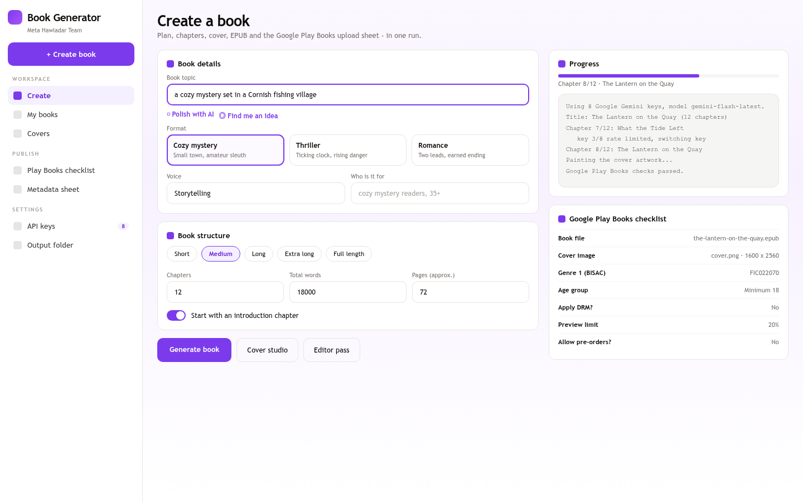

# Book Generator
**Meta Hawladar Team**


Give it a topic. It plans the book, writes every chapter, paints one cover from
the title with FLUX.1-schnell, builds a validated EPUB, and fills in every field
the storefront upload form asks for.

One repository, two apps, one build:

| folder | app | language | output |
|---|---|---|---|
| `desktop/` | Windows / Linux / macOS | Dart (Flutter) | installer, portable zip, tar.gz, .app |
| `app/` | Android | Kotlin (Jetpack Compose) | signed APK |

Both apps contain the same pipeline, written natively for each platform - no
server, no backend. Network requests go directly to Gemini Web with your own session, or to NVIDIA APIs with your own keys.

## Interface



Light violet house style on both platforms - white cards on a faint violet
wash, 10 px radii, `#7C3AED` as the one accent colour. The right-hand panel is a
live **publishing checklist**: every field the storefront asks for, grouped,
with the reason behind each recommendation and a copy button on each value.
The same list writes `metadata.txt`, so the screen and the file can never drift
apart.

## Models

Two rolling aliases, so the app follows Google's current flash models without a
code change:

| model | use it for |
|---|---|
| `gemini-flash-latest` | default - best prose quality per rupee |
| `gemini-flash-lite-latest` | cheapest and fastest, good for drafts and long books |

## Build

1. Push this whole folder to one GitHub repository, keeping `desktop/` and
   `app/` side by side at the repo root.
2. GitHub -> **Actions** -> **Build All Apps** -> **Run workflow** -> choose
   targets (default `android+windows`) -> **Run workflow**.
3. When it finishes, open the run -> **Artifacts** -> download the APK and the
   Windows installer.

Tag a version to publish one GitHub Release with everything attached:

```
git tag v1.0.0 && git push --tags
```

### Android signing

Add these repository secrets before distributing
(*Settings -> Secrets and variables -> Actions*):

```
KEYSTORE_BASE64   base64 of your release.keystore
KEYSTORE_PASSWORD
KEY_ALIAS
KEY_PASSWORD
```

Without them CI generates a throwaway key, so the APK installs for testing but
every build is signed differently and users cannot update in place.

## Using the app

1. Open **Session & API keys**. Paste your own signed-in Gemini cookie JSON
   (Playwright storageState or cookie-export array), then use **Test Gemini session**.
   The test sends a tiny prompt to your account. Cookies are memory-only; paste again after an app restart.
   NVIDIA still accepts API keys from build.nvidia.com.
2. Type a topic, pick Fiction or Non-fiction, set chapters and total words.
3. Press **Generate book**.

You get a folder containing:

```
plan.json      the book bible, blurb, keywords, chapter briefs
summary.txt    the running story-so-far used to keep chapters consistent
chapters/      one Markdown file per chapter
cover.png      1600 x 2560, ready for any store
<Title>.epub   validated EPUB 3
metadata.txt   title, blurb, BISAC, keywords, price, age rating, DRM advice
<Title>-publishing-kit.zip   all of the above in one archive
```

## Built to the Google Play Books rules

Every file this app produces is shaped by the Partner Center guidelines, not by
guesswork:

- **EPUB 3**, the complete book, with the front cover embedded. Google accepts
  only `.epub` or `.pdf`; `.doc` and `.html` are rejected.
- **A `bodymatter` landmark**, so the free sample opens on chapter 1 instead of
  the copyright page.
- **PNG images only**, inside the supported GIF / JPEG / PNG / SVG set, and no
  JavaScript, MathML or multi-column CSS - Play Books renders none of those.
- **Cover saved separately** as a 1600 x 2560 PNG, inside Google's 640 px
  minimum and 7200 px maximum.
- **BISAC genres, capped at three**, most relevant first, because Play Store
  genres are built on BISAC and Google recommends no more than three.
- **Reflowable text**, so the book works on every screen Play Books supports.
- **A rules check at the end of every run.** If the book is too short, the
  description is empty, there is no genre or the cover falls outside Google's
  size limits, the log says so before you waste an upload.

`metadata.txt` mirrors the Partner Center form field by field - Format, Title,
Subtitle, Series, Volume in series, Contributors, Biographical notes,
Description, Subject standard, Genres, Language, Publisher, Related books, Age
group, For mature audiences, Publication date, Release date, Pre-orders, DRM,
preview limit and page count.

## AI cover artwork

`Cover art (AI image)` turns the cover from generated geometry into a painted
scene. The writing model is asked for a single art-director prompt, the image
image provider is asked to paint it at 9:16, and the renderer lays the typography over it with
scrims so the title always reads.

| provider | image models |
|---|---|
| Gemini Web | `gemini-web-image` (web-selected image model; availability depends on your account) |
| NVIDIA | `flux.1-schnell`, `flux.1-dev`, `stable-diffusion-3.5-large` |

`Off` keeps the geometric cover. **New artwork** on a finished book paints a
fresh picture and rebuilds the EPUB, the metadata sheet and the ZIP. The raw
picture is saved as `cover-art.png` inside the publishing kit.

## Editor pass

When a book is finished, press **Editor pass**. The whole manuscript goes back
to the model as a continuity and line editor, which returns a score out of 100,
an honest verdict, and a list of real problems: contradictions in names, dates,
places or clues; repeated images and beats; filler; pacing. Every issue tied to
a chapter gets a **Rewrite chapter N** button. The report is saved as
`quality-report.md` and travels in the ZIP.

## Rewrite a single chapter

Open **Chapters** on any finished book and press **Rewrite** next to the one you
do not like. Say what should change; the chapter is rewritten against the book
bible and everything the reader knew up to that point, then the EPUB, the
metadata sheet and the ZIP are rebuilt around it. The rest of the book is
untouched.

## Cover studio

Press **Cover studio** and the app renders four covers: the current one plus
three honest alternatives. Pick one, or build your own with the colour, layout
(`center`, `left`, `bottom`) and font (`serif`, `sans`) pickers, and **Shuffle**
to redraw the artwork. The chosen cover is written straight into the EPUB, the
`cover.png` and the ZIP.

## Front & back matter

Open **Front & back matter** before generating and the book is built with the
pages a paid title is expected to have:

* a proper copyright page (rights notice, fiction disclaimer, imprint, edition
  year, cover credit);
* an **About the author** page - yours, or the one the planner wrote;
* an **Also by** list of your other titles;
* a short, non-pushy **review request** naming Google Play Books;
* an optional **Stay in touch** page.

## Batch: many books in one run

The topic box takes **one topic per line**. Three lines means three complete
books, written back to back with the same settings, author and cover theme.

* The button becomes **Generate 3 books** and the progress bar covers the whole
  queue ("Writing book 2 of 3...").
* A book that fails does not kill the batch - the error is logged and the next
  topic starts.
* **Cancel** stops after the current book; whatever finished is kept.
* When more than one book is done you also get
  `batch-YYYY-MM-DD-N-books.zip` with every book in its own folder, plus the
  usual per-book ZIP.

## Two providers

Pick the back end in **Provider**. Gemini now uses a cookie session, not an API key.
The Gemini web service chooses the underlying model; the app does not promise a specific Flash/Pro model.
NVIDIA retains its own API keys and model list.

| provider | models |
| --- | --- |
| Gemini Web | `gemini-web (cookie)` (label, not a selectable official API model) |
| NVIDIA (build.nvidia.com) | `z-ai/glm-5.2`, `nvidia/nemotron-3-super-120b-a12b`, `nvidia/nemotron-3-ultra-550b-a55b`, `nvidia/nemotron-3.5-lightning-30b-a3b` |

NVIDIA is called through its OpenAI-compatible endpoint
(`integrate.api.nvidia.com/v1/chat/completions`) with your `nvapi-...` keys.
Nemotron's thinking mode is switched through `chat_template_kwargs`, and a
`<think>` block in the reply is stripped before the text reaches the book.
Rough guide: **glm-5.2** for most books, **nemotron-3-ultra** for a plot that
has to hold together, **nemotron-3.5-lightning** for cheap fast drafts.

## Bulk API keys

For NVIDIA only: paste API keys into the NVIDIA box, one per line (commas and spaces work too). The app:

* rotates to the next key on every request, so no single key eats the whole
  free-tier rate limit;
* parks a key for 60 seconds when it returns `429`, and for an hour when it is
  rejected outright, then carries on with the others;
* never prints a key in the log - only `key 3/8 rate limited, switching key`.

One NVIDIA key still works. NVIDIA keys are stored locally as before.

## Gemini cookie sessions

The supplied web client is integrated on desktop; Android contains a native Kotlin port.
There is no Gemini API-key fallback. Text writing, JSON planning and optional web-generated
cover artwork use the session. The web endpoint is unofficial and can change without notice;
a locally valid cookie export does not prove the server will accept it.

* Use only an account you own or are authorized to use. Never share a cookie export in chat,
  a Git repository, a book ZIP, or a support log: it grants account access.
* Cookies are kept in application memory, not preferences or output files. Restarting the
  app (or Android recreating the activity/process) requires pasting them again.
* Credentials are sent only to `https://gemini.google.com`; automatic redirects are disabled.
  Artwork downloads use an allowlisted Google image host without account cookies.
* Session expiry, account limits, login challenges and protocol changes can interrupt a run.
  Re-export a fresh signed-in session if rejected. This does not bypass account quotas.
* Web mode cannot enforce API temperature, output-token or thinking-budget settings. System
  instructions and JSON requests are included in the prompt instead.
* **Test Gemini session** performs a live handshake and tiny generation. No real account
  was used during development; run this test locally before generating a full book.
* Choose **Off - geometric cover** if your account cannot generate/download images.

## Length: words or pages

**Chapters**, **Total words** and **Pages** sit next to each other and the last
two are linked: 1 page is counted as about 250 words, the same rule storefronts
use for an ebook page count. Type `80` pages and the word target becomes
`20000`; type the words and the page estimate follows. Set whichever number you
actually care about.

## Downloading the result

When the book is finished the app packs every artefact into
`<Title>-publishing-kit.zip`.

* **Desktop** - press **Download ZIP** and pick where to save it.
* **Android** - press **Download ZIP (everything)**, choose a folder in the
  system file picker, or use **Share ZIP** to send it to Drive, Telegram, email
  or anywhere else.

## How the writing stays coherent

The planner first produces a **book bible**: for fiction the setting, cast,
motives, the real culprit, every clue and where it is planted, and the ending;
for non-fiction the framework and the through-line argument. Every chapter is
then written against that bible plus a **running summary** that is rewritten
after each chapter. That is what stops chapter 14 contradicting chapter 3.

## Cover themes

`ember` warm night - mystery, thriller, drama
`frost` cold blue - noir, winter, literary
`forest` green-gold - cozy, rural, historical
`rose` pink-violet - romance, women's fiction
`slate` dark tech - business, non-fiction, self-help
`sand` warm neutral - memoir, essays, guides

Leave the theme on **auto** and the planner picks one to match the genre.

## Upload defaults the metadata sheet already recommends

- DRM: **No**
- Preview limit: **20%**
- Allow pre-orders: **No** - switch to Yes only for book 2 or later in a series
- Maximum age: leave blank
- ISBN: leave blank, the distributor assigns one free

## Repository layout

```
.github/workflows/build-all.yml   one workflow builds everything
desktop/
  lib/main.dart                   Flutter UI
  lib/src/gemini.dart             Shared NVIDIA API key pool
  lib/src/gemini_web.dart         Gemini cookie-session web client
  lib/src/prompts.dart            every model-facing prompt
  lib/src/plan.dart               planner output model
  lib/src/writer.dart             plan -> chapters -> cover -> EPUB
  lib/src/cover.dart              cover renderer and the six themes
  lib/src/epub.dart               EPUB 3 builder
  lib/src/zipwriter.dart          ZIP writer (mimetype must be stored first)
  lib/src/markdown.dart           Markdown -> XHTML
  lib/src/metadata.dart           the upload sheet
  assets/icon/                    app icons for every platform
  installer/windows.iss           Inno Setup script
app/
  app/build.gradle.kts            versionName lives here
  app/src/main/java/com/metahawladar/bookgenerator/
    MainActivity.kt               Compose UI
    Gemini.kt  GeminiWeb.kt  Prompts.kt  Plan.kt  BookWriter.kt
    CoverRenderer.kt  EpubBuilder.kt  Markdown.kt  MetadataSheet.kt
```
